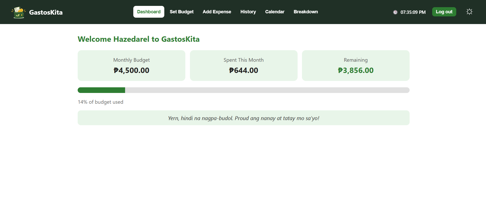
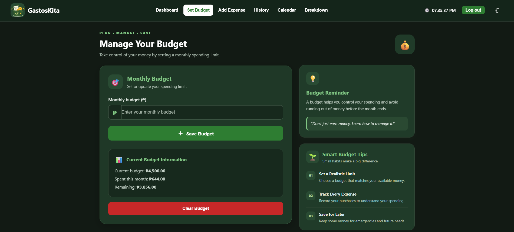

 <p align="center">
  
</p>

<h1 align="center">GastosKita</h1>

<p align="center">
  <strong>Make Every Peso Count.</strong>
  <br>
  A Student Budgeting and Expense Tracking Application
</p>

<p align="center">
  
  
  
  
  
</p>

<p align="center">
  <a href="#about-gastoskita">About</a> •
  <a href="#key-features">Features</a> •
  <a href="#oop-concepts">OOP Concepts</a> •
  <a href="#system-architecture">Architecture</a> •
  <a href="#technologies-used">Technologies</a> •
  <a href="#application-showcase">Showcase</a> •
  <a href="#getting-started">Getting Started</a> •
  <a href="#meet-the-team">Team</a>
</p>

---

<a id="about-gastoskita"></a>
## 📌 About GastosKita

**GastosKita** is a student-focused budgeting and expense tracking application designed to help students manage their money more responsibly. It provides a simple way to record daily expenses, monitor spending habits, set budgets, and track financial progress.

The application aims to encourage better financial decisions by making expense monitoring more accessible, organized, and engaging.

With GastosKita, students can keep track of where their money goes and make every peso count.

---

<a id="key-features"></a>
## ✨ Key Features

- **Dashboard** – Displays an overview of expenses, budget status, and financial activity.
- **Add Expense** – Allows users to record expenses and organize them by category.
- **Expense History** – Provides a record of previously added expenses.
- **Set Budget** – Lets users establish a spending limit to manage their finances.
- **Calendar** – Organizes expense records according to their dates.
- **Spending Breakdown** – Presents expense distribution across different categories.
- **Saving Suggestions** – Provides practical tips to encourage smarter spending habits.
- **Budget Notifications** – Displays witty and informative reminders about spending activity.
- **Dark and Light Mode** – Allows users to switch between different interface themes.

### Expense Categories

- 🍔 Food
- 🚌 Transportation
- 🛍️ Shopping
- 🎮 Entertainment
- 📦 Others

---

<a id="oop-concepts"></a>
## 🧩 Object-Oriented Programming Concepts

GastosKita applies the fundamental principles of Object-Oriented Programming through its Java implementation.

| OOP Concept | Implementation |
|---|---|
| **Abstraction** | The abstract `Expense` class defines common expense properties and methods. |
| **Encapsulation** | Private fields protect expense data, with controlled access through methods. |
| **Inheritance** | Specific expense classes inherit common properties and behaviors from `Expense`. |
| **Polymorphism** | Subclasses provide their own implementations of methods such as `getCategoryName()` and `getSavingTip()`. |
| **Factory Design Pattern** | `ExpenseFactory` creates the appropriate expense object based on its category. |
| **Exception Handling** | `InvalidInputException` provides a custom exception for invalid expense input. |

---

<a id="system-architecture"></a>
## 🏗️ System Architecture

GastosKita uses a Java-based backend connected to a MySQL database, while the user interface is built with HTML, CSS, and JavaScript.

<p align="center">
  
</p>

---

<a id="technologies-used"></a>
## 💻 Technologies Used

| Technology | Purpose |
|---|---|
| **Java** | Backend development and OOP implementation |
| **HTML5** | Application structure |
| **CSS3** | Styling and responsive interface |
| **JavaScript** | Frontend functionality and interactions |
| **MySQL** | Database management |
| **XAMPP** | Local database environment |
| **Git & GitHub** | Version control and collaboration |
| **Visual Studio Code** | Code editing and development |

---

<a id="application-showcase"></a>
## 📸 Application Showcase

Explore the six main pages of GastosKita.

### 1. Dashboard
<p align="center">
  
</p>

### 2. Set Budget
<p align="center">
  
</p>

### 3. Add Expense
<p align="center">
  
</p>

### 4. Expense History
<p align="center">
  
</p>

### 5. Calendar
<p align="center">
  
</p>

### 6. Spending Breakdown
<p align="center">
  
</p>

---

## 📂 Project Structure

```text
GastosKita/
│
├── database/
│   └── schema.sql
│
├── lib/
│   └── mysql-connector-j-26.7.0.jar
│
├── out/
│   └── Compiled Java Classes
│
├── screenshots/
│   ├── dashboard.png
│   ├── set-budget.png
│   ├── add-expense.png
│   ├── history.png
│   ├── calendar.png
│   ├── breakdown.png
│   ├── system-architecture.png
│   │
│   └── team/
│       ├── haze.jpg
│       ├── camille.jpg
│       └── steve.png
│
├── src/
│   ├── Expense.java
│   ├── ExpenseFactory.java
│   ├── FoodExpense.java
│   ├── TransportationExpense.java
│   ├── ShoppingExpense.java
│   ├── EntertainmentExpense.java
│   ├── OthersExpense.java
│   ├── Budget.java
│   ├── InvalidInputException.java
│   ├── DBConnection.java
│   └── GastosKitaServer.java
│
├── web/
│   ├── index.html
│   ├── style.css
│   ├── app.js
│   ├── header.png
│   ├── logo.png
│   └── logo-icon.png
│
└── README.md
```

---

<a id="getting-started"></a>
## 🚀 Getting Started

Follow these steps to run GastosKita on your local machine.

### Prerequisites

Make sure you have installed the following:

- Java Development Kit (JDK)
- Visual Studio Code
- XAMPP
- Git

### 1. Clone the Repository

```bash
git clone https://github.com/calchaze/GastosKita_OOP_Project_-Group1.git
```

### 2. Open the Project Folder

```bash
cd GastosKita_OOP_Project_-Group1
```

### 3. Set Up the Database

1. Open XAMPP Control Panel.
2. Start Apache and MySQL.
3. Open phpMyAdmin.
4. Create or import the database using `database/schema.sql`.
5. Check the database configuration in `src/DBConnection.java`.

### 4. Compile the Java Files

Open the terminal in the project directory and run:

```powershell
javac -cp "lib/mysql-connector-j-26.7.0.jar" -d out src/*.java
```

### 5. Run the Application

```powershell
java -cp "out;lib/mysql-connector-j-26.7.0.jar" GastosKitaServer
```

### 6. Open the Application

Open your browser and navigate to the local address displayed by the server.

---

## 🔮 Future Improvements

- Additional budgeting and financial tracking tools.
- More detailed spending reports and insights.
- Improved user experience and accessibility.
- Additional features to support students' saving goals.

---

<a id="meet-the-team"></a>
## 👥 Meet the Team

GastosKita was brought to life through the collaboration, creativity, and dedication of Team 1.

<table>
  <tr>
    <td align="center" width="33%">
      
      <br><br>
      <strong>Albuñán, Haze Darel L.</strong>
      <br><br>
      UI/UX Designer & Frontend Developer
      <br><br>
      <a href="https://github.com/calchaze">
        
      </a>
    </td>
    <td align="center" width="33%">
      
      <br><br>
      <strong>Epa, Camille P.</strong>
      <br><br>
      Project Lead & Docs Architect
      <br><br>
      <a href="GITHUB_LINK_CAMILLE">
        
      </a>
    </td>
    <td align="center" width="33%">
      
      <br><br>
      <strong>Manalo, Steve Nash E.</strong>
      <br><br>
      Lead Backend & OOP Engineer
      <br><br>
      <a href="GITHUB_LINK_STEVE">
        
      </a>
    </td>
  </tr>
</table>

---

## 🙏 Acknowledgment

This project would not have been possible without the guidance and support of our Object-Oriented Programming instructor at **Batangas State University – The National Engineering University (Alangilan Campus)**, College of Informatics and Computing Sciences (CICS).

The knowledge and insights shared throughout the course helped us transform our understanding of Java and Object-Oriented Programming into a functional application.

We also extend our appreciation to our classmates and fellow students who shared their suggestions and feedback, helping us make GastosKita more relevant to the everyday financial needs of students.

---

<p align="center">
  <strong>Thank you for exploring GastosKita!</strong>
  <br><br>
  We code the system, you make every peso count.
  <br>
  Proudly built by <strong>Team 1 – GastosKita</strong>.
</p>
