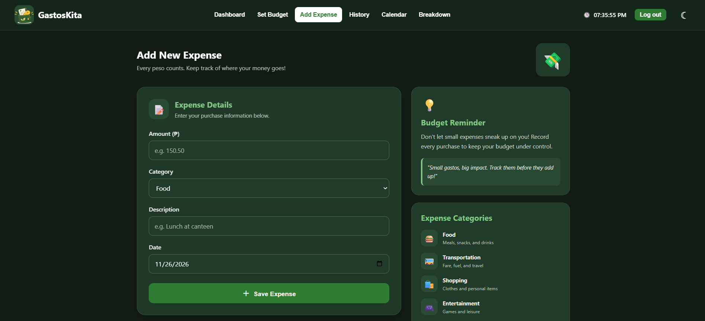
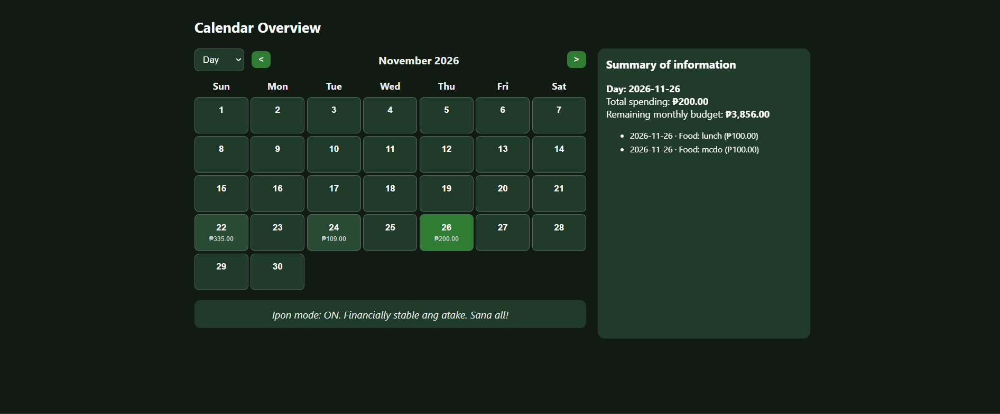
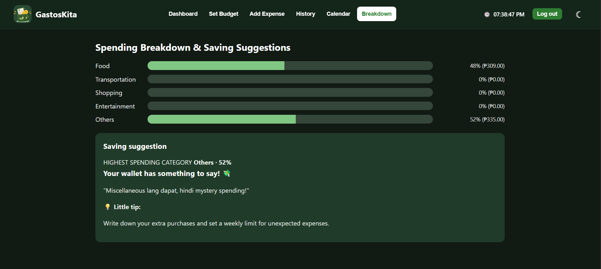

 <p align="center">
  
</p>

<h1 align="center">GastosKita</h1>

<p align="center">
  
</p>

<p align="center">
  <strong>MAKE EVERY PESO COUNT.</strong>
  <br>
  Your money, your choices, your progress.
  <br><br>
  A student-focused budgeting and expense tracking application.
</p>

<p align="center">
  
  
  
  
  
</p>

<p align="center">
  <a href="#-the-story-behind-gastoskita">Our Story</a> •
  <a href="#-what-you-can-do">Features</a> •
  <a href="#-built-with-oop">OOP</a> •
  <a href="#-under-the-hood">Architecture</a> •
  <a href="#-take-a-look-around">Gallery</a> •
  <a href="#-getting-started">Installation</a> •
  <a href="#-the-people-behind-it">Team</a>
</p>

---

<p align="center">
  <strong>💚 SMALL SAVINGS. SMARTER CHOICES. BETTER HABITS.</strong>
</p>

<a id="-the-story-behind-gastoskita"></a>
## 🌱 The Story Behind GastosKita

Ever wondered where your allowance goes before the week even ends?

Between food, transportation, school supplies, and spontaneous purchases, keeping track of expenses can be challenging for students. That's where **GastosKita** comes in.

GastosKita is a budgeting and expense tracking application created to help students become more aware of their spending habits. It provides a convenient space to record expenses, manage budgets, review financial activity, and discover opportunities to save.

More than just recording numbers, GastosKita encourages students to make thoughtful financial decisions—one peso at a time.

<p align="center">
  <strong>Because managing money isn't about how much you have.</strong>
  <br>
  It's about knowing how to use it.
</p>

---

<a id="-what-you-can-do"></a>
## ✨ What You Can Do

GastosKita brings everyday budgeting tools together in one organized workspace.

<table>
  <tr>
    <td width="50%" valign="top">
      <h3>📊 Dashboard</h3>
      Get a quick overview of your expenses, budget, and financial activity.
    </td>
    <td width="50%" valign="top">
      <h3>➕ Add Expense</h3>
      Record daily purchases and organize them into expense categories.
    </td>
  </tr>
  <tr>
    <td width="50%" valign="top">
      <h3>📜 Expense History</h3>
      Review previously recorded expenses and keep track of spending activity.
    </td>
    <td width="50%" valign="top">
      <h3>🎯 Set Budget</h3>
      Establish spending limits and become more mindful of your allowance.
    </td>
  </tr>
  <tr>
    <td width="50%" valign="top">
      <h3>📅 Calendar</h3>
      View and organize expenses according to their recorded dates.
    </td>
    <td width="50%" valign="top">
      <h3>📈 Spending Breakdown</h3>
      Understand how your money is distributed across different categories.
    </td>
  </tr>
  <tr>
    <td width="50%" valign="top">
      <h3>💡 Saving Suggestions</h3>
      Discover practical tips that encourage better spending habits.
    </td>
    <td width="50%" valign="top">
      <h3>🔔 Witty Budget Messages</h3>
      Receive witty and informative reminders about your spending activity.
    </td>
  </tr>
</table>

### 🧾 Where Does Your Money Go?

Expenses are organized into five categories:

| Category | Description |
|---|---|
| 🍔 Food | Meals, snacks, and drinks |
| 🚌 Transportation | Daily travel expenses |
| 🛍️ Shopping | Personal purchases and essentials |
| 🎮 Entertainment | Leisure and recreational spending |
| 📦 Others | Expenses outside the listed categories |

**A little reminder:** Every expense tells a story. GastosKita helps you keep track of yours.

---

<a id="-built-with-oop"></a>
## 🧩 Built with OOP

Behind GastosKita's interface is a Java implementation that applies fundamental Object-Oriented Programming principles.

| Concept | How We Applied It |
|---|---|
| **Abstraction** | The abstract `Expense` class defines shared expense properties and methods. |
| **Encapsulation** | Private fields protect expense information and provide controlled access. |
| **Inheritance** | Specific expense classes inherit common properties and behaviors from `Expense`. |
| **Polymorphism** | Subclasses implement their own versions of methods such as `getCategoryName()` and `getSavingTip()`. |
| **Factory Design Pattern** | `ExpenseFactory` creates the appropriate expense object based on its category. |
| **Exception Handling** | `InvalidInputException` provides a custom exception for invalid expense input. |


<a id="-under-the-hood"></a>
## 🏗️ Under the Hood

GastosKita combines frontend technologies, Java backend functionality, and a MySQL database to provide its budgeting experience.

<p align="center">
  
</p>

### 🛠️ Technology Stack

| Technology | What It Does |
|---|---|
| ☕ **Java** | Backend logic and OOP implementation |
| 🌐 **HTML5** | Structures the application interface |
| 🎨 **CSS3** | Handles styling and visual presentation |
| ⚡ **JavaScript** | Powers frontend interactions |
| 🗄️ **MySQL** | Stores and manages application data |
| 🔧 **XAMPP** | Provides the local database environment |
| 🐙 **Git & GitHub** | Supports version control and collaboration |
| 💻 **Visual Studio Code** | Development and code editing environment |

---

<a id="-take-a-look-around"></a>
## 🖼️ Take a Look Around

Explore the different screens and features of GastosKita.

<table>
  <tr>
    <th width="50%">Dashboard</th>
    <th width="50%">Set Budget</th>
  </tr>
  <tr>
    <td align="center">
      
    </td>
    <td align="center">
      
    </td>
  </tr>
  <tr>
    <th>Add Expense</th>
    <th>Expense History</th>
  </tr>
  <tr>
    <td align="center">
      
    </td>
    <td align="center">
      
    </td>
  </tr>
  <tr>
    <th>Calendar</th>
    <th>Spending Breakdown</th>
  </tr>
  <tr>
    <td align="center">
      
    </td>
    <td align="center">
      
    </td>
  </tr>
</table>

<p align="center">
  <sub>Every feature is designed to make managing your money simpler and more organized.</sub>
</p>
---

## 📁 Inside the Project

Here's how the project files are organized:

```text
GastosKita/
│
├── database/
│   └── schema.sql
│
├── lib/
│   └── mysql-connector-j-26.7.0.jar
│
├── out/
│   └── Compiled Java Classes
│
├── screenshots/
│   ├── dashboard.png
│   ├── set-budget.png
│   ├── add-expense.png
│   ├── history.png
│   ├── calendar.png
│   ├── breakdown.png
│   ├── system-architecture.png
│   │
│   └── team/
│       ├── haze.jpg
│       ├── camille.jpg
│       └── steve.png
│
├── src/
│   ├── Expense.java
│   ├── ExpenseFactory.java
│   ├── FoodExpense.java
│   ├── TransportationExpense.java
│   ├── ShoppingExpense.java
│   ├── EntertainmentExpense.java
│   ├── OthersExpense.java
│   ├── Budget.java
│   ├── InvalidInputException.java
│   ├── DBConnection.java
│   └── GastosKitaServer.java
│
├── web/
│   ├── index.html
│   ├── style.css
│   ├── app.js
│   ├── header.gif
│   ├── header.png
│   ├── logo.png
│   └── logo-icon.png
│
└── README.md
```

---

<a id="-getting-started"></a>
## 🚀 Getting Started

Want to explore GastosKita on your own machine? Follow the instructions below.

### Requirements

Before running the application, make sure you have:

- Java Development Kit (JDK)
- Visual Studio Code
- XAMPP
- Git

### 01. Clone the Repository

```bash
git clone https://github.com/calchaze/GastosKita_OOP_Project_-Group1.git
```

### 02. Open the Project Folder

```bash
cd GastosKita_OOP_Project_-Group1
```

### 03. Prepare the Database

1. Open the XAMPP Control Panel.
2. Start Apache and MySQL.
3. Open phpMyAdmin.
4. Create or import the database using `database/schema.sql`.
5. Check the database configuration in `src/DBConnection.java`.

### 04. Compile the Java Files

Open the terminal in the project directory and execute:

```powershell
javac -cp "lib/mysql-connector-j-26.7.0.jar" -d out src/*.java
```

### 05. Run GastosKita

```powershell
java -cp "out;lib/mysql-connector-j-26.7.0.jar" GastosKitaServer
```

### 06. Open the Application

Open your browser and navigate to the local address displayed by the server.

---

<a id="-whats-next"></a>
## 🔮 What's Next?

There is always room to grow. Some possible future improvements include:

- More budgeting and financial tracking tools.
- More detailed spending reports and insights.
- Improved user experience and accessibility.
- Additional features to support students' saving goals.

---

 <a id="-the-people-behind-it"></a>
## 👥 The People Behind It

<p align="center">
  Behind every project is a team that turns ideas into something real.
  <br>
  Meet <strong>Team 1 – GastosKita</strong>, the people behind the design, development, and documentation.
</p>

<table align="center" width="85%">
  <tr>
    <td align="center" width="33%" valign="top">
      
      <br><br>
      <strong>Albuñan, Haze Darel L.</strong>
      <br>
      <sub>UI/UX Designer & Frontend Developer</sub>
      <br><br>
      <a href="https://github.com/calchaze">
        
      </a>
    </td>
    <td align="center" width="33%" valign="top">
      
      <br><br>
      <strong>Epa, Camille P.</strong>
      <br>
      <sub>Project Lead & Docs Architect</sub>
      <br><br>
      <a href="https://github.com/camille03-IT">
        
      </a>
    </td>
    <td align="center" width="33%" valign="top">
      
      <br><br>
      <strong>Manalo, Steve Nash E.</strong>
      <br>
      <sub>Lead Backend & OOP Engineer</sub>
      <br><br>
      <a href="https://github.com/Nash-M20">
        
      </a>
    </td>
  </tr>
</table>

---

## 💌 A Little Appreciation

This project is a product of learning, collaboration, and the shared effort to turn classroom concepts into something meaningful.

We sincerely express our gratitude to our Object-Oriented Programming instructor, **Ms. Fatima Marie Agdon**, at **Batangas State University – The National Engineering University (Alangilan Campus)**, **College of Informatics and Computing Sciences (CICS)**, for her guidance, knowledge, and encouragement throughout the development of this project.

We also appreciate our classmates and fellow students who shared their thoughts, suggestions, and feedback along the way.

Every lesson, challenge, and contribution helped shape **GastosKita** into what it is today.

---

<p align="center">
  
  <br><br>
  <strong>THANK YOU FOR STOPPING BY!</strong>
  <br>
  <sub>Here's to smarter spending and better saving habits.</sub>
  <br><br>
  <strong>MAKE EVERY PESO COUNT. 💚</strong>
  <br><br>
  <sub>Designed with purpose. Built with teamwork. Made for every peso.</sub>
  <br>
  <strong>© Team 1 – GastosKita</strong>
</p>

<p align="center">
  
</p>
