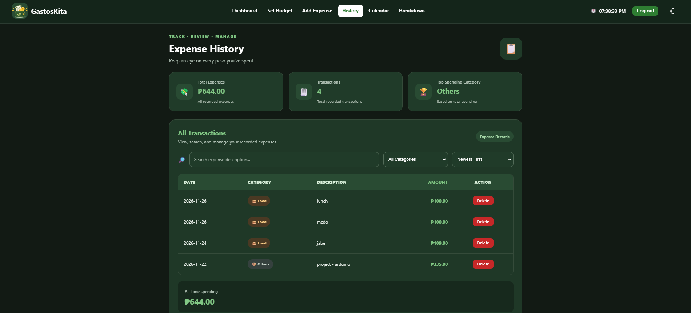

  

<h1 align="center">💸 GastosKita</h1>

  <strong>Make Every Peso Count.</strong>
   
  A Student Budgeting and Expense Tracking System

  Helping students build better spending habits, manage their budgets, and stay on top of their expenses.

  
  
  
  
  

  <a href="#-about-gastoskita">About</a> •
  <a href="#-key-features">Features</a> •
  <a href="#-oop-concepts">OOP Concepts</a> •
  <a href="#-technologies-used">Technologies</a> •
  <a href="#-application-showcase">Showcase</a> •
  <a href="#-getting-started">Getting Started</a> •
  <a href="#-meet-the-team">Team</a>

---

## 📌 About GastosKita

*GastosKita* is a student-focused budgeting and expense tracking application designed to help users become more aware of their spending habits and manage their money more effectively.

The system allows students to record expenses, organize transactions, set budgets, and monitor their spending through an organized and user-friendly interface.

With practical budgeting tools and friendly reminders, GastosKita encourages students to make smarter financial decisions and develop responsible money management habits.

## ✨ Key Features

<strong>💸 Expense Tracking</strong>

Record daily expenses and organize them into different categories:

- Food
- Transportation
- Shopping
- Entertainment
- Others

<strong>📜 Expense History</strong>

View previously recorded expenses and keep track of past transactions.

<strong>🎯 Budget Management</strong>

Set a budget and monitor your spending to stay within your planned financial limit.

<strong>📅 Expense Calendar</strong>

View expenses according to their recorded dates through a calendar interface.

<strong>📊 Spending Breakdown</strong>

Understand where your money goes through a visual breakdown of expenses by category.

<strong>💡 Saving Suggestions</strong>

Get helpful suggestions that encourage better spending habits and smarter budgeting decisions.

<strong>🔔 Witty Budget Notifications</strong>

Receive friendly and humorous notifications that remind users to stay mindful of their spending.

<strong>🌗 Light and Dark Mode</strong>

Switch between light and dark themes for a more comfortable viewing experience.

## 🧩 OOP Concepts

GastosKita applies Object-Oriented Programming concepts in organizing its Java backend.

| Concept | Implementation |
|---|---|
| *Encapsulation* | Organizing data and related methods within classes. |
| *Inheritance* | Expense category classes build upon the common Expense class. |
| *Polymorphism* | Supporting different expense types through their shared expense structure. |
| *Factory Design Pattern* | ExpenseFactory handles the creation of expense objects. |
| *Exception Handling* | InvalidInputException handles invalid input scenarios. |

## 🛠️ Technologies Used

| Technology | Purpose |
|---|---|
| Java | Backend development and OOP implementation |
| HTML5 | Web page structure |
| CSS3 | Interface styling and layout |
| JavaScript | Frontend interactions |
| MySQL | Database management |
| JDBC | Java-to-MySQL connectivity |
| MySQL Connector/J | MySQL JDBC driver |
| XAMPP | Local MySQL database environment |
| phpMyAdmin | Database administration |
| Visual Studio Code | Development environment |
| Git and GitHub | Version control and collaboration |

## 🖥️ Application Showcase

Explore the GastosKita interface and see how its features help students manage their expenses and budgets.

<table>
  <tr>
    <td align="center" width="50%">
      <strong>📊 Spending Breakdown</strong>  
      
    </td>
    <td align="center" width="50%">
      <strong>📜 Expense History</strong>  
      
    </td>
  </tr>
  <tr>
    <td align="center" width="50%">
      <strong>📅 Expense Calendar</strong>  
      
    </td>
    <td align="center" width="50%">
      <strong>💸 Add Expense</strong>  
      
    </td>
  </tr>
  <tr>
    <td align="center" colspan="2">
      <strong>🎯 Budget Management</strong>  
      
    </td>
  </tr>
</table>

## 📁 Project Structure

text
GastosKita_Group1/
│
├── database/
│   └── schema.sql
│
├── lib/
│   └── mysql-connector-j-26.7.0.jar
│
├── out/
│   ├── Budget$Status.class
│   ├── Budget.class
│   ├── DBConnection.class
│   ├── EntertainmentExpense.class
│   ├── Expense.class
│   ├── ExpenseCategory.class
│   ├── ExpenseDAO.class
│   ├── ExpenseFactory.class
│   ├── FoodExpense.class
│   ├── GastosKitaServer.class
│   ├── InvalidInputException.class
│   ├── PopupMessages$1.class
│   ├── PopupMessages.class
│   ├── ShoppingExpense.class
│   └── TransportationExpense.class
│
├── src/
│   ├── Budget.java
│   ├── DBConnection.java
│   ├── EntertainmentExpense.java
│   ├── Expense.java
│   ├── ExpenseCategory.java
│   ├── ExpenseDAO.java
│   ├── ExpenseFactory.java
│   ├── FoodExpense.java
│   ├── GastosKitaServer.java
│   ├── InvalidInputException.java
│   ├── OthersExpense.java
│   ├── PopupMessages.java
│   ├── ShoppingExpense.java
│   └── TransportationExpense.java
│
├── web/
│   ├── app.js
│   ├── header.png
│   ├── index.html
│   ├── logo-dark.png
│   ├── logo-icon.png
│   ├── logo.png
│   └── style.css
│
├── screenshots/
│   ├── breakdown.png
│   ├── history.png
│   ├── calendar.png
│   ├── add-expense.png
│   └── set-budget.png
│
└── README.md

## 🚀 Getting Started

Follow these instructions to set up and run GastosKita on your local machine.

### Prerequisites

Make sure you have installed:

- [Java Development Kit (JDK)](https://www.oracle.com/java/technologies/downloads/)
- [XAMPP](https://www.apachefriends.org/)
- [Visual Studio Code](https://code.visualstudio.com/)
- [Git](https://git-scm.com/)

### 1. Clone the Repository

Open your terminal and run:

git clone https://github.com/calchaze/GastosKita_OOP_Project_-Group1.git

Navigate to the project directory:

cd GastosKita_OOP_Project_-Group1

### 2. Set Up the Database

1. Open the XAMPP Control Panel.
2. Start *MySQL*.
3. Open phpMyAdmin at http://localhost/phpmyadmin.
4. Create the database using the database name configured in DBConnection.java.
5. Select the database you created.
6. Open the *Import* tab.
7. Choose the database/schema.sql file.
8. Click *Import* or *Go* to execute the SQL file.

### 3. Configure the Database Connection

Open:

text
src/DBConnection.java

Check the database connection settings and make sure these match your local MySQL configuration:

- Database name
- MySQL host
- MySQL port
- Username
- Password

### 4. Compile the Java Files

From the project root directory, open the terminal and run:

javac -cp "lib/mysql-connector-j-26.7.0.jar" -d out src/*.java

### 5. Run GastosKita

Run the Java server:

java -cp "out;lib/mysql-connector-j-26.7.0.jar" GastosKitaServer

Once the server starts, follow the local address and port configured in GastosKitaServer.java to open the application in your browser.

## 🔮 Future Improvements

GastosKita may be further improved through:

- More detailed spending analytics.
- Additional budgeting tools.
- Improved saving recommendations.
- Enhanced user experience and accessibility.
- Additional features that support responsible financial habits.

## 👥 Meet the Team

GastosKita was developed through the collaboration of the following team members.

| Team Member | Role |
|---|---|
| *Albuñán, Haze Darel L.* | UI/UX Designer & Frontend Developer |
| *Epa, Camille P.* | Project Lead & Docs Architect |
| *Manalo, Steve Nash E.* | Lead Backend & OOP Engineer |

## 🙌 Acknowledgment

This project was developed as part of our Object-Oriented Programming coursework. We would like to acknowledge our instructor for the guidance and feedback throughout the development process.

We also thank everyone who contributed their time, effort, and ideas to make GastosKita possible.

---

  <strong>GastosKita — Make Every Peso Count. 💚</strong>
   
  Track your gastos. Take control of your budget.

  <a href="#-gastoskita">Back to Top ↑</a>

